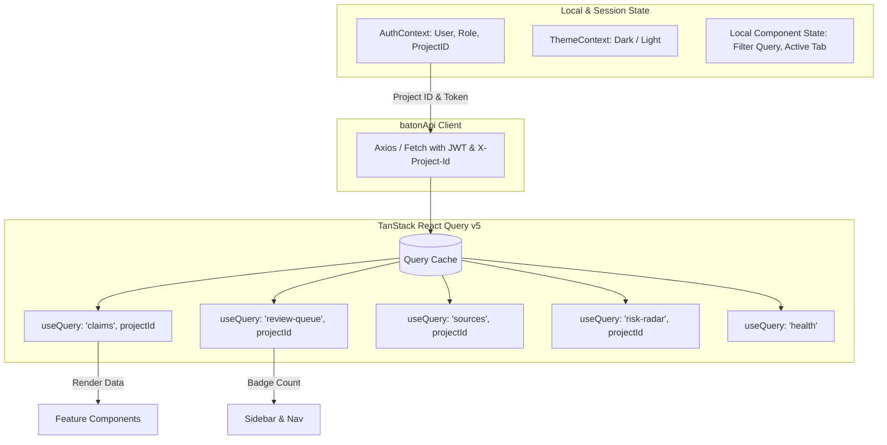

# Baton — Frontend Architecture Specification

## 1. Overview

The **Baton Frontend** is an enterprise-grade Single Page Application (SPA) built with **React 18**, **Vite 5.4**, **TypeScript 5.6**, and **Tailwind CSS 3.4**. It is engineered to provide an ultra-responsive, zero-latency experience for reviewing complex engineering knowledge bases, resolving conflicts, and navigating interconnected project entities.

---

## 2. Design Principles & UI Philosophy

### 2.1. Dual-Theme Parity (Cinematic Dark & Clean Enterprise Light)
Every view in Baton offers complete feature and visual parity across two meticulously crafted themes:
- **Cinematic Dark Glass Mode** (`DashboardLayoutDark.tsx`): Deep violet/slate glassmorphism (`bg-black/40`, `backdrop-blur-xl`, `border-white/10`) with glowing violet accents (`#a855f7`) designed for immersive deep-work sessions.
- **Clean Enterprise Light Mode** (`DashboardLayoutLight.tsx`): Crisp, accessible slate canvas (`bg-[#f8fafc]`, `border-slate-200`, `shadow-sm`) with high-contrast typography optimized for executive reviews and compliance audits.

### 2.2. "Evidence at Your Fingertips"
The interface guarantees that no claim is displayed as a bare text string. Clicking any claim or citation opens the **`SourceDrawer`**, rendering the exact source document, metadata tags, and highlighting the verbatim quote that backs the assertion.

### 2.3. Zero-Layout Shift & Optimistic Updates
All dynamic content containers reserve explicit geometry using CSS aspect ratios and skeleton placeholders. State transitions (such as confirming a claim or resolving a conflict) reflect immediately via **TanStack React Query** cache updates with automatic rollback on error.

---

## 3. Architecture Hierarchy

```
frontend/src/
├── api/                       # Centralized typed HTTP client & query helpers
│   ├── client.ts              # batonApi wrapper with automatic JWT and X-Project-Id injection
│   └── types.ts               # Shared TypeScript schemas matching backend Pydantic models
│
├── app/                       # Application Shell & Routing
│   ├── App.tsx                # BrowserRouter with ProtectedRoute guards
│   ├── auth.tsx               # Auth provider integration
│   └── routes.tsx             # Route declarations with lazy-loaded page chunks
│
├── components/                # Reusable UI Primitives & Global Layouts
│   ├── common/                # OptimizedImage, SearchBar, ThemeToggle, PillBadge
│   ├── hero/                  # ThreeHeroNode (Three.js WebGL canvas interactive nodes)
│   ├── invitation/            # InviteMemberModal with role selection
│   ├── layout/                # DashboardLayoutDark, DashboardLayoutLight, TopHeader
│   └── navigation/            # Role-gated Sidebar, ProjectSwitcher, Breadcrumbs
│
├── context/                   # Global React State Providers
│   ├── AuthContext.tsx        # Active user, persona switcher, Supabase session
│   └── ThemeContext.tsx       # Dark/Light theme toggle with localStorage persistence
│
├── features/                  # Domain-Driven Feature Slices
│   ├── access/                # L1-L4 Least-Privilege Access Matrix & dynamic clearance counts
│   ├── audit/                 # Append-only audit logs with SHA-256 verification indicator
│   ├── dashboard/             # Project state overview, KPI metrics, mini knowledge graph
│   ├── graph/                 # Interactive Cytoscape.js 2D relationship explorer
│   ├── handover/              # Transition package reader, Day-1/Week-1/Month-1 checklist, Ask Baton
│   ├── ledger/                # Claim Ledger, honesty status filtering, SourceDrawer citations
│   ├── review/                # Review Queue, Disagreement resolver, Gap Interview, Snapshot approval
│   ├── risk/                  # Bus-factor meter, single-owner modules, commit/PR timeline
│   ├── settings/              # Project telemetry, system health, active clearance badge
│   └── sources/               # Source upload, GitHub/Jira sync, drift alerts, inventory table
│
└── shared/                    # Atomic UI Primitives (Button, Modal, Input, Drawer, Skeleton)
```

---

## 4. State Management Architecture



### Key Query Cache Features:
1. **Tenant-Keyed Namespaces**: All query keys are scoped to the active project (e.g. `['claims', user?.project_id]`). Switching projects instantly invalidates old queries and fetches tenant-isolated records.
2. **Coordinated Invalidations**: Actions such as uploading a new PDF automatically invalidate downstream queries across `sources`, `drift-alerts`, `claims`, `dashboard`, `knowledge-graph`, `timeline`, and `risk-radar`.
3. **Reactive Sidebar Review Badge**: `DashboardLayout` queries `batonApi.getReviewQueue()` dynamically. The review badge reflects live pending items and disappears entirely when the queue is clear (`effectiveReviewCount === 0`).

---

## 5. Feature Slices Deep Dive

### 5.1. Sources & Connectors (`features/sources`)
- **Direct File Ingestion**: Upload modal supporting PDF, DOCX, TXT, MD, Git JSON, and Task CSV with client-side format validation and size checks (< 10MB).
- **Live Connector Hub**: Cards for GitHub and Jira Cloud sync status with last-sync timestamps and added/skipped record telemetry.
- **Source Inventory Table**: Responsive table showing Source Title, Type, Access Level (L1–L3), Chunks count, Original Source URL (or "Uploaded file"), and Parse Status.
- **Drift Change Alerts**: Notifies approvers when re-uploaded sources detect content changes (`134 -> 138 chunks`) based on deterministic SHA-256 chunk hashes.

### 5.2. Claim Ledger (`features/ledger`)
- **Honesty Status Filter**: Filter claims across `Verified`, `Inferred`, `Conflicting`, `Missing`, and `Attested`.
- **Verbatim Evidence Drawer**: Clicking any claim opens `SourceDrawer`, highlighting the exact quote inside the full document context.
- **Project State Reconstruction**: One-click trigger to reconstruct project claims from newly ingested chunks.

### 5.3. Interactive Knowledge Graph (`features/graph`)
- **Cytoscape.js Engine**: High-performance canvas rendering handling hundreds of interconnected nodes without frame drops.
- **Typed Entity Clustering**: Distinct visual node styling for **People** (blue), **Modules** (purple), **Tasks** (green), **Claims** (amber), and **Sources** (cyan).
- **Relationship Edges**: Explicit semantic links labeled `AUTHORED`, `OWNS`, `IMPORTS`, `BLOCKS`, and `SUPPORTED BY`.
- **Graph Controls**: Full pan, zoom, fit-to-screen, and entity filter toggles (`People`, `Modules`, `Tasks`, `Claims`).

### 5.4. Review Queue & Conflict Resolution (`features/review`)
- **Approval Bar**: Top-level handover readiness indicator displaying total confirmed claims, blockers, and single-click "Confirm all verified".
- **Conflict Resolver Modal**: Side-by-side comparison of contradictory claims with citation sources and recommendation heuristics.
- **Uncertainty Acceptance**: Approvers can accept unresolved uncertainties by providing a mandatory rationale note.
- **Gap Interview Dispatch**: Send targeted questions to departing leavers to clarify missing context.
- **Version Snapshot Sealing**: One-click freezing of the verified Claim Ledger with canonical SHA-256 verification.

### 5.5. Handover Roadmaps & Ask Baton (`features/handover`)
- **Role-Tailored Onboarding Roadmaps**: Displays structured execution plans categorized into **Day 1 (Access & Setup)**, **Week 1 (Architecture & Workflows)**, and **Month 1 (Ownership & Delivery)**.
- **Interactive Progress Checklists**: Checkboxes for incoming engineers to track onboarding tasks (`not_started`, `in_progress`, `completed`).
- **Ask Baton**: Natural language Q&A interface grounded exclusively in the approved handover snapshot, rendering verbatim citations with every answer.

---

## 6. Performance Optimization & Bundle Strategy

The frontend build employs advanced code-splitting and optimization strategies in `vite.config.ts`:

| Bundle / Chunk | Gzip Size | Contents & Purpose |
| :--- | :--- | :--- |
| `index-*.js` | ~23 kB | Core application router, auth state, layout shell |
| `react-vendor-*.js` | ~78 kB | React 18, React DOM, React Router v6 |
| `query-vendor-*.js` | ~12 kB | TanStack React Query v5 core and cache |
| `motion-vendor-*.js`| ~51 kB | Framer Motion animation primitives |
| `cytoscape-vendor-*.js`| ~144 kB | Cytoscape.js graph layout engine (lazy loaded) |
| `three-vendor-*.js` | ~132 kB | Three.js WebGL hero canvas (lazy loaded) |

### Optimization Highlights:
- **LCP Optimization**: Critical SVG and logo assets are preloaded with `fetchpriority="high"` and explicit dimensions (`width` and `height`) to eliminate layout shifts (CLS = 0.00).
- **Self-Hosted Web Fonts**: Preloaded Inter and Geist display fonts using `font-display: swap`.
- **Dynamic Feature Imports**: Heavy screens (Knowledge Graph, ThreeHeroNode, Handover) are loaded on-demand via `React.lazy()`.
