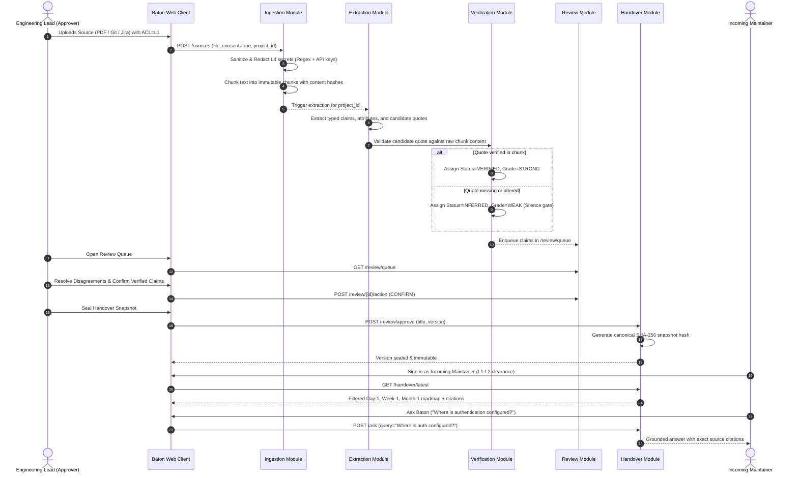

# Baton — System Architecture Specification

## 1. Executive Summary

**Baton** is an enterprise-grade knowledge continuity and engineering handover platform designed to eliminate institutional brain drain when critical engineering talent transitions between teams or organizations. 

Traditional handovers rely on unstructured documentation, stale wikis, and hurried handover meetings that fail to capture the tribal knowledge, unwritten architectural constraints, and single-owner dependencies that maintain system reliability. Baton solves this by transforming multi-source project evidence (Git history, Jira tickets, architectural PDFs, task boards, meeting transcripts) into an immutable, cryptographically verifiable, role-gated **Claim Ledger**.

---

## 2. Core Architectural Invariants

Every subsystem across Baton is engineered around four non-negotiable architectural invariants:

### 2.1. "Citation or Silence"
A fact is never accepted into the Claim Ledger without an exact or whitespace-normalized verbatim quote directly from an ingested source chunk. If a statement cannot be grounded in verifiable evidence, the system abstains (**Silence**) rather than hallucinating or guessing.

### 2.2. Multi-Tiered Least Privilege (L1–L4 Clearance)
All imported records, chunks, claims, and timeline events are tagged with an Access Control Level (ACL):
- **L1 (Team-Wide)**: Public to all project roles (Contributors, Maintainers, Approvers).
- **L2 (Maintainers Only)**: Architecture guidelines, runbooks, internal deployment procedures.
- **L3 (Leadership Only)**: Confidential budgets, compensation, vendor agreements, strategy.
- **L4 (Private Secrets & Keys)**: Credentials, private keys, API secrets, personal phone numbers/emails. **L4 is strictly redacted and rejected at ingest**; it is never stored, indexed, or rendered.

### 2.3. Append-Only Immutability & Auditability
Once a handover version is reviewed and approved, its state is frozen with a canonical SHA-256 hash. Review actions (confirming claims, resolving conflicts, accepting uncertainties) append cryptographically signed audit logs with actor attribution and timestamps.

### 2.4. Strict Project & Tenant Isolation
All database queries, background sync tasks, and API routes enforce tenant boundaries via `project_id` and the `X-Project-Id` request header. Cross-project lookups return uniform `404 Not Found` responses to prevent ID guessing or metadata leakage.

---

## 3. High-Level System Architecture

```
┌────────────────────────────────────────────────────────────────────────────────────────┐
│                                  BATON WEB CLIENT                                      │
│                                (React 18 + Vite SPA)                                   │
│  ┌───────────────────────┐  ┌───────────────────────┐  ┌────────────────────────────┐  │
│  │   Sources & Sync      │  │  Claim Ledger & Graph │  │ Review Queue & Disagreements│  │
│  │  - File Upload (PDF)  │  │  - Verbatim Highlights│  │  - Approval Checklist      │  │
│  │  - GitHub & Jira Sync │  │  - Cytoscape 2D Graph │  │  - Gap Interview (Leaver)  │  │
│  │  - Drift Alerts       │  │  - Filter & Search    │  │  - Version Sealing         │  │
│  └───────────────────────┘  └───────────────────────┘  └────────────────────────────┘  │
│  ┌───────────────────────┐  ┌───────────────────────┐  ┌────────────────────────────┐  │
│  │   Risk Radar & Commits│  │  Handover Roadmaps    │  │  Access Control & Telemetry│  │
│  │  - Bus Factor (100%)  │  │  - Day-1/Week-1/Month-1│  │  - L1–L4 Clearance Matrix  │  │
│  │  - Commit Activity    │  │  - Exportable Markdown│  │  - Tamper-Evident Audit    │  │
│  │  - Blocked Tasks      │  │  - Ask Baton (Q&A)    │  │  - System Health Telemetry │  │
│  └───────────────────────┘  └───────────────────────┘  └────────────────────────────┘  │
└───────────────────────────────────────────┬────────────────────────────────────────────┘
                                            │ HTTP / JSON (JWT + X-Project-Id)
                                            ▼
┌────────────────────────────────────────────────────────────────────────────────────────┐
│                                FASTAPI BACKEND MONOLITH                                │
│                                   (Python 3.11+)                                       │
│                                                                                        │
│  ┌──────────────────────────────────────────────────────────────────────────────────┐  │
│  │ CORE ENGINE: Security Middleware, Role Verification, Project Isolation, Audit Log│  │
│  └──────────────────────────────────────────────────────────────────────────────────┘  │
│                                                                                        │
│  ┌──────────────────┐    ┌──────────────────┐    ┌──────────────────────────────────┐  │
│  │ Ingestion Engine │ -> │Extraction Pipeline│ -> │ Verification & Citation Engine   │  │
│  │ - PDF/DOCX/MD/CSV│    │ - Entity Extractor│    │ - Exact Quote Match              │  │
│  │ - Git/Jira Sync  │    │ - Claim Synthesizer│   │ - Confidence Grading             │  │
│  │ - Secret Redactor│    │ - Attribute Mapper│   │ - "Citation or Silence" Gate     │  │
│  └──────────────────┘    └──────────────────┘    └──────────────────────────────────┘  │
│            │                                                       │                   │
│            ▼                                                       ▼                   │
│  ┌──────────────────┐    ┌──────────────────┐    ┌──────────────────────────────────┐  │
│  │ Drift Engine     │    │ Risk Radar Engine│    │ Review & Handover Engine         │  │
│  │ - SHA-256 Hashes │    │ - Bus-Factor     │    │ - Review Queue & Conflicts       │  │
│  │ - Chunk Diffing  │    │ - Activity Graph │    │ - Leaver Gap Interview           │  │
│  │ - Change Alerts  │    │ - Blocked Chains │    │ - Version Snapshot Sealing       │  │
│  └──────────────────┘    └──────────────────┘    └──────────────────────────────────┘  │
└───────────────────────────────────────────┬────────────────────────────────────────────┘
                                            │
                                            ▼
┌────────────────────────────────────────────────────────────────────────────────────────┐
│                                     DATA LAYER                                         │
│  ┌───────────────────────────────┐           ┌──────────────────────────────────────┐  │
│  │ PostgreSQL / SQLite (WAL)     │           │ Supabase Auth & Storage              │  │
│  │ - Sources & Source Chunks     │           │ - JWT Token Verification             │  │
│  │ - Claims, Citations, Gaps     │           │ - OAuth Providers (GitHub / Google)  │  │
│  │ - Versions & Audit Events     │           │ - User Session Management            │  │
│  └───────────────────────────────┘           └──────────────────────────────────────┘  │
└────────────────────────────────────────────────────────────────────────────────────────┘
```

---

## 4. End-to-End Data Lifecycle



---

## 5. Security & Multi-Tenancy Architecture

### 5.1. Authentication & Identity Mapping
- **Supabase Auth**: Authenticates users using Email/Password, Magic Links, or OAuth (GitHub/Google).
- **Session Tokens**: Cryptographically signed JWTs passed in the `Authorization: Bearer <token>` header.
- **Seeded Personas**: Fully autonomous demo personas allow instant sandbox evaluation (`approver`, `incoming_maintainer`, `contributor`, `leaver`).

### 5.2. Role-Based Access Control (RBAC)
Baton enforces 4 distinct engineering handover roles:

| Role | Permissions | Clearance Ceiling |
| :--- | :--- | :--- |
| **Approver** | Full administrative rights: source upload, live connector sync, claim confirmation, conflict resolution, version sealing, audit inspection, gap interview dispatch. | **L1, L2, L3** |
| **Incoming Maintainer** | Transition recipient: view approved handover versions, explore knowledge graph, inspect timeline events, execute Day-1/Week-1/Month-1 action items, query Ask Baton. | **L1, L2** |
| **Contributor** | Active engineer: view team-wide project facts and timeline events, review public code dependencies. Confidential cards appear as count placeholders. | **L1** |
| **Leaver** | Departing engineer: restricted exclusively to the **Gap Interview** portal to clarify open questions dispatched by the Approver. | **Restricted / Sandboxed** |

---

## 6. Database Schema Architecture

The persistence layer is organized across 7 modular migration slices:

1. `10_core.sql`: Projects, users, authentication sessions, and append-only audit event logs.
2. `20_ingestion.sql`: Sources, source chunk fragments, content hashes, and live provider metadata.
3. `30_risk.sql`: Module definitions, bus-factor concentration records, and task dependency chains.
4. `40_extraction.sql`: Extracted facts, entities, attributes, and candiate citation quotes.
5. `50_review.sql`: Review queue items, conflict pairs, gap interview questions, and human resolutions.
6. `60_handover.sql`: Sealed immutable versions, canonical snapshot hashes, and roadmap action items.
7. `70_drift.sql`: Baseline source hashes, drift scan logs, and active source change alerts.

---

## 7. Operational & Deployment Architecture

- **Frontend Client**: Hosted on **Vercel** with global Edge CDN caching, immutable asset hashes, and HTTP/2 multiplexing.
- **Backend API**: Hosted on **Render** (Dockerized FastAPI container) running Uvicorn with auto-scaling workers.
- **Database**: Managed **PostgreSQL** instance with connection pooling, transactional serialization, and WAL recovery.
